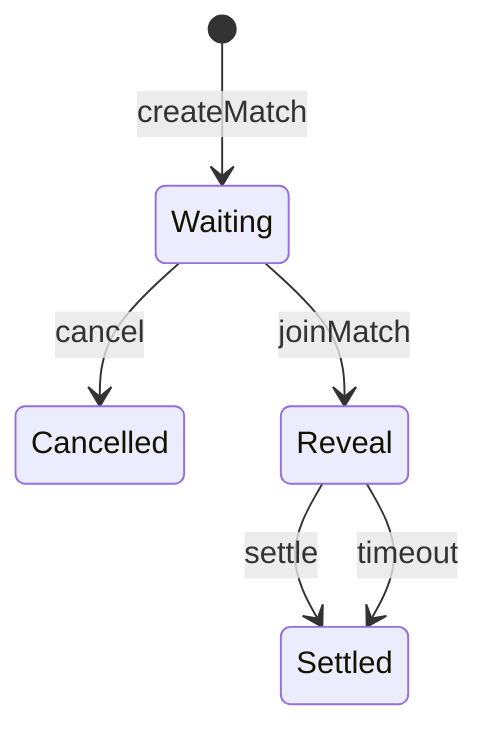

# PvP rock-paper-scissors

Local proof of concept. Two wallets stake the same amount of token, commit to a throw, reveal it, and the contract pays the winner. Practice blackjack is unchanged. The heads-up blackjack spec in `docs/pvp/` is a different game and is still unbuilt.

The chain for this proof is Anvil, chain id `31337`. The token is `MockUSDC` (6 decimals). `mint` is public so a developer can faucet. Do not deploy that token on a public network.

## Outcomes

| Throw | Beats |
| --- | --- |
| Rock (`1`) | Scissors |
| Paper (`2`) | Rock |
| Scissors (`3`) | Paper |

The same throw is a tie.

## Money

A match has one stake, chosen by the creator. The opponent must lock the same amount. The minimum stake is 1 USDC (`1_000_000` units).

The pot is both stakes. The fee is `pot / 1000` (0.1 percent), the same rate as the blackjack escrow spec. On a 20 USDC stake the pot is `40_000_000`, the fee is `40_000`, and the winner is credited `39_960_000`.

A tie credits both stakes and charges no fee. Cancelling a lobby credits the creator's stake and charges no fee. If neither player reveals, both stakes come back and the fee is zero.

Payouts are credits. The wallet calls `claim()` to receive tokens. The contract sets the credit to zero before the token transfer. No function can sweep a player's funds. The owner can pause and unpause. Pause blocks `createMatch` and `joinMatch` only.

The fee recipient, the token, and the owner are set in the constructor. The owner cannot be changed.

## Commit and reveal

The second player must not see the first throw before locking their own. Each player stores a commit, then reveals after both have joined.

```
commit = keccak256(abi.encode(uint8 choice, bytes32 salt))
```

`choice` is 1, 2, or 3. `salt` is a random 32-byte value the player keeps until reveal. Three choices means a missing or short salt can be guessed. The contract checks `commitHash(choice, salt)` against the commit stored for that seat.

Reveal is allowed after the deadline until someone calls `timeout`. A late reveal still counts if `timeout` has not been mined, because the commit was already binding.

## State

`createMatch` opens a lobby. `joinMatch` locks the second stake and starts a 10 minute reveal window. The creator may `cancel` while the match is still waiting. After 10 minutes with no opponent, anyone may `cancel`, which refunds the creator. `joinMatch` reverts once that window has passed.

`settle` pays a match once both seats have revealed. Anyone may call it.

`timeout` reverts until the reveal deadline. After that:

- Both revealed: same payout as `settle`.
- One revealed: that player wins the pot minus the fee. Refusing to reveal loses the stake.
- Neither revealed: both stakes are credited back.



## Build order

Each task is finished only after `forge test` and a script against Anvil both pass. One branch, `rps-pvp`, off `main`.

| Task | What it adds | Local check |
| --- | --- | --- |
| 1 | Foundry project and `MockUSDC` | `scripts/rps/01-token.sh` |
| 2 | Create, join, cancel, claim | `scripts/rps/02-lobby.sh` |
| 3 | Reveal and settle, including a tie | `scripts/rps/03-settle.sh` |
| 4 | Reveal timeout, forfeit, and empty refund | `scripts/rps/04-timeout.sh` |
| 5 | Pause, and a reentrancy check on `claim` | `scripts/rps/05-pause.sh` |
| 6 | Deploy script and one Anvil run of the whole game | `scripts/rps-local.sh` |

## Run the whole local game

Anvil has to be free on port `8545`. The script starts it, deploys, plays every path, and stops it. The shell commands, the bash checks, and the mistakes that make a check lie are in [foundry.md](foundry.md).

```bash
npm run chain:e2e
```

Foundry tests alone, with no Anvil:

```bash
npm run chain:test
```

Interactive chain:

```bash
anvil --host 127.0.0.1 --port 8545 --chain-id 31337
npm run chain:deploy
```

`chain:deploy` writes `contracts/broadcast/local.json` with the token and game addresses. The first Anvil account is the owner. The third Anvil account receives fees. Both keys are Anvil's published defaults and are used only against this local chain.

The browser table is in [ui.md](ui.md). `npm run chain:env` then `npm run rps:dev` serves it at http://127.0.0.1:5173/rps. `npm run rps:check` plays a match in Chromium against a throwaway Anvil.

Mint 100,000 fake USDC to a player. The amount is `100_000_000_000` units.

```bash
cast send "$USDC" "mint(address,uint256)" "$PLAYER" 100000000000 \
  --private-key 0xac0974bec39a17e36ba4a6b4d238ff944bacb478cbed5efcae784d7bf4f2ff80 \
  --rpc-url http://127.0.0.1:8545
```

## Later

- Best of three
- A public-network token that is not `MockUSDC`
- Writing the result onto the fake-chip leaderboard
